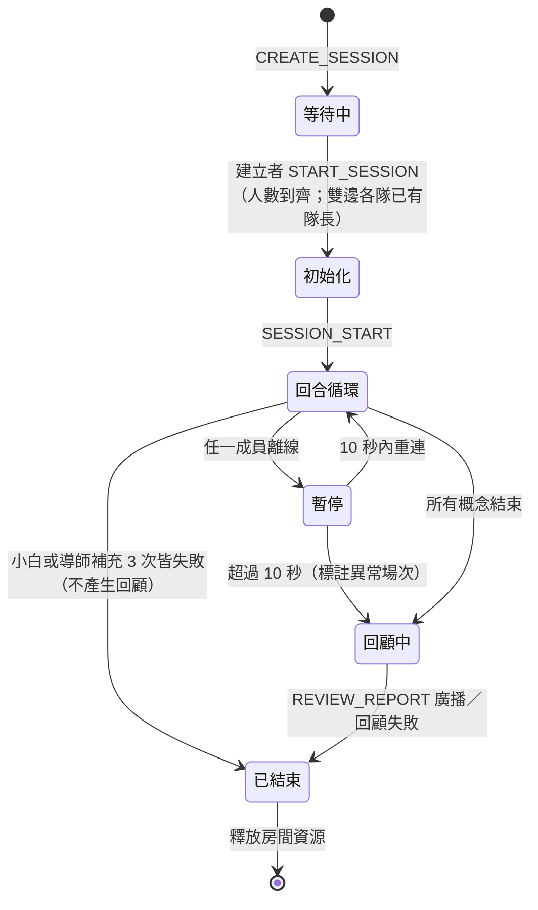
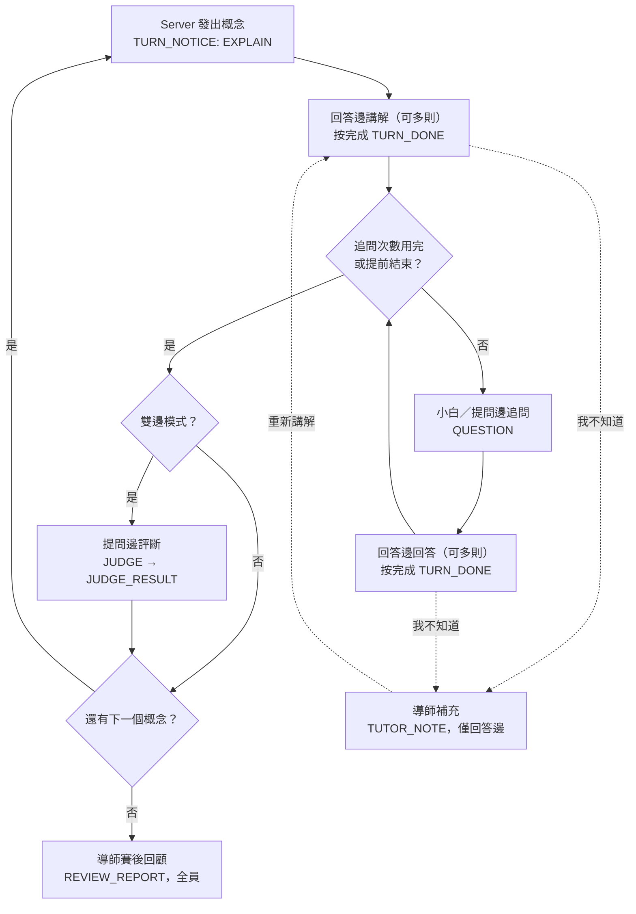

# 費曼 × 哈柏露塔 協作學習系統 PRD

> 版本：v1.3（2026-10-17）· 作者：@Hong
> 分工：Server（後端）@Hong；Client（前端）另一位組員
> 變更：v1.1 依 2026-10-17 逐項決策補齊未定義之處；v1.2 Server 改用 FastAPI（REST + WebSocket、asyncio），改寫 §9 與 §10；v1.3 確認可用 FastAPI，LLM 定為 Claude Sonnet 5.5，AI 提示詞改由後端撰寫。見 [§16 決策紀錄](#16-決策紀錄)

## 目錄

1. [產品概述](#1-產品概述)
2. [目標與非目標](#2-目標與非目標)
3. [使用者與使用情境](#3-使用者與使用情境)
4. [角色與出場規則](#4-角色與出場規則)
5. [模式規格](#5-模式規格)
6. [場次設定](#6-場次設定)
7. [功能需求](#7-功能需求)
8. [流程與狀態機](#8-流程與狀態機)
9. [通訊協定](#9-通訊協定)
10. [非功能需求與異常處理](#10-非功能需求與異常處理)
11. [風險與取捨](#11-風險與取捨)
12. [開發分層與里程碑](#12-開發分層與里程碑)
13. [驗收標準](#13-驗收標準)
14. [書面報告對照](#14-書面報告對照)
15. [待決事項](#15-待決事項)
16. [決策紀錄](#16-決策紀錄)

---

## 1. 產品概述

本系統是以**費曼學習法**與**哈柏露塔學習法**為核心的即時多人學習平台：學習者用自己的話講解概念，由夥伴或 AI 追問；AI 導師只在學習者明確求救時補充，並在整場結束後回顧錯誤。

本專案為網路程式設計期末專題，兩人一組，以 Python 實作 Server 與 Client 兩個模組：Server 採 FastAPI（REST + WebSocket），Client 採圖形化介面。

| 比較項目 | Kahoot | 直接用 ChatGPT 學習 | 本系統 |
| --- | --- | --- | --- |
| 學習者的動作 | 選擇答案 | 與 AI 對話提問 | 用自己的話講解，並被追問 |
| 糾錯時機 | 每題結束顯示對錯 | 隨時由 AI 回應 | 求救時補充，其餘留到賽後回顧 |
| 多人互動 | 搶答與排名 | 無 | 分隊、輪流講解與提問 |
| AI 的角色 | 無 | 單一對話對象 | 導師（求救與賽後）、小白（僅單邊模式） |

## 2. 目標與非目標

第一版要在單邊與雙邊兩種模式下，完整跑通「講解 → 追問 → 求救 → 賽後回顧」的流程，並同時滿足課程對 Server 與 Client 的基本要求。

### 目標

- **G1**：實作單邊與雙邊兩種模式，涵蓋費曼的講解與哈柏露塔的互相提問。
- **G2**：AI 導師只有兩個入口——使用者明確求救、整場結束後的回顧。
- **G3**：題數、追問次數、導師補充字數、人數由場次建立者在建立前設定。
- **G4**：Server 負責帳號、配對、發言權控制、訊息轉送、場次狀態維護與異常離線偵測。
- **G5**：AI 呼叫失敗時重試並提示使用者；3 次皆失敗則通知使用者並結束場次，不讓場次卡死。

### 非目標（第一版不做）

- 語音輸入與語音講解。
- AI 自動評分講解品質；雙邊模式的評斷由提問邊人工判斷。
- 過程中的即時糾錯；使用者答錯但未求救時，AI 不介入。
- 內建的教材與題目編輯器。
- 計分與排名；雙邊模式只記錄提問邊「接受／不接受」。
- **階段計時**：各階段不設時間限制，由成員手動推進。
- 對話紀錄的事後查閱介面（紀錄仍保存於 Server）。
- 傳輸加密：使用 HTTP／WS（非 HTTPS／WSS），帳號密碼與 token 以明文傳送，僅適用課堂 demo 環境。

## 3. 使用者與使用情境

系統有兩種使用者：**場次建立者**與**參與者**（建立者也是參與者之一）。建立者建立場次後取得場次代號，交給其他人以加入。

| 情境 | 組成 | 模式 | AI 角色 |
| --- | --- | --- | --- |
| 單人自學 | 1 位使用者 | 單邊 | 導師、小白 |
| 同隊多人 | 多位使用者在同一邊 | 單邊 | 導師、小白 |
| 兩隊對戰 | 使用者分成兩隊 | 雙邊 | 僅導師 |

- 一位使用者同時只能在一個場次中。
- 同一帳號重複登入時，Server 中斷舊連線，以新連線為準。

## 4. 角色與出場規則

AI 導師只在**回答邊成員按下「我不知道」**或**整場結束**時出場；使用者答錯但沒有求救時，AI 一律不介入，流程照常進行。

| 項目 | AI 導師 | AI 小白 |
| --- | --- | --- |
| 職責 | 求救時補充；賽後回顧並補充 | 聽完講解後追問，逼使用者說人話 |
| 適用模式 | 單邊、雙邊 | 僅單邊 |
| 觸發條件 | 回答邊成員按下「我不知道」，或整場結束 | 回答邊送出講解或回答並按「完成」 |
| 可存取資訊 | 教材、完整對話紀錄 | 只看到本概念的講解與問答紀錄（不含教材與導師內容） |
| 輸出限制 | 求救補充 ≤「導師補充字數」（字元數，超過由 Server 截斷）；賽後回顧不限長度，格式為固定 JSON | 每個概念追問 ≤「追問次數」，判斷已講清楚時可提前結束 |
| 禁止事項 | 教材沒提到的內容不得斷言 | 不得陳述事實或評論對錯，只能問「為什麼」「那是什麼意思」「舉個例子」 |

補充說明：

- 小白看不到教材與導師的內容，才能維持「什麼都不懂的外行人」設定，也避免在導師刻意沉默時洩漏答案。小白能看到自己問過的問題與對方的回答，以免重複提問。
- **可見範圍**：導師的求救補充只送給回答邊，提問邊看不到；賽後回顧送給所有成員。
- 建立者可選擇讓 AI 在建立場次前根據教材生成概念。這不屬於導師在學習過程中的出場。

## 5. 模式規格

- **回答邊**：負責講解與回答。
- **提問邊**：負責提問。
- 單邊模式中，使用者這一邊就是回答邊，由 AI 小白擔任提問者；雙邊模式由兩隊輪流擔任回答邊與提問邊，AI 只當導師。

### 5.1 發言規則（兩種模式共通）

- **講解與回答可多則**：回答邊任何成員都可以送出多則講解或回答，Server 全部轉送給全場；回答邊任一成員按下「完成」（`TURN_DONE`）後才進入下一步。Server 至少收到一則後才接受「完成」。
- **提問只收一則**：每輪提問 Server 只收第一則 `QUESTION`，收到後即進入回答階段，之後同輪的提問回 `ERROR`。
- **求救不限次數**：回答邊任何成員在講解或回答階段都可按「我不知道」，每個概念不限次數；導師處理中不能再按。求救後回答邊須重新講解，**已用的追問次數延續，不歸零**。

### 5.2 單邊模式（單人或同隊多人）

1. Server 依「題數」依序發出概念。
2. 回答邊成員講解（可多則），按「完成」。
3. AI 小白依本概念的講解與問答紀錄追問，回答邊成員回答（可多則）並按「完成」；最多追問「追問次數」次，小白判斷已講清楚時可提前結束。追問結束即該概念結束。
4. 回答邊成員隨時可按「我不知道」（見[求救流程](#81-求救流程)）。
5. 所有概念結束後，導師做賽後回顧。

### 5.3 雙邊模式（兩隊）

1. Server 發出概念，指定本回合的回答邊與提問邊，下一回合互換；第一回合由建立者指定的隊伍先當回答邊。題數為奇數時，先答的隊伍會多答一題。
2. 回答邊成員講解（可多則），按「完成」。
3. 提問邊任一成員提問（每輪只收第一則），回答邊成員回答（可多則）並按「完成」，算一輪；最多「追問次數」輪。提問邊任一成員可按「結束提問」（`END_QUESTIONS`）提前進入評斷。
4. 回答邊成員可按「我不知道」；導師補充只有回答邊看得到，提問邊看不到，所以回答邊須**用自己的話重新講解一次**。答錯但未求救時，AI 不介入。
5. 評斷：提問邊每位成員各投一票「接受／不接受」，全部投完後以**多數決**為準；**平手時由提問邊隊長決定**。Server 只廣播結果與票數（`JUDGE_RESULT`），個別票不公開；結果記錄但不計分。
6. 所有概念結束後，導師做賽後回顧。

> 雙邊模式中 AI 不評斷對錯，評斷權完全在提問邊；若提問邊接受了錯誤的解釋，會在賽後回顧中被指出。

## 6. 場次設定

場次建立者在建立場次前必須完成下列設定；**場次建立後設定即鎖定，大廳等待期間也不能修改**。

### 6.1 數值參數

| 參數 | 說明 | 適用模式 | 預設值 | 範圍 |
| --- | --- | --- | --- | --- |
| 題數 | 本場的概念數量；輸入數量後，介面產生對應數量的概念輸入格 | 單邊、雙邊 | 5 | 1 ~ 10 |
| 追問次數 | 每個概念最多追問次數；單邊由 AI 小白追問，雙邊由提問邊提問 | 單邊、雙邊 | 3 | 1 ~ 5 |
| 導師補充字數 | 導師每次求救補充的字元數上限 | 單邊、雙邊 | 150 字 | 50 ~ 300 字 |
| 人數 | 單邊：總人數；雙邊：每隊人數（兩隊相同） | 單邊、雙邊 | 單邊 1；雙邊每隊 2 | 單邊 1 ~ 6；雙邊每隊 1 ~ 5 |

### 6.2 其他設定

- **模式**：單邊或雙邊。
- **先答隊伍**（雙邊）：第一回合由哪一隊當回答邊。
- **隊伍分配**（雙邊）：加入者在 `JOIN_SESSION` 時自己選隊，已滿的隊伍不能選。
- **隊長**（雙邊）：開始前每隊須有一位隊員自願擔任隊長（多人同時自願時，以 Server 先收到者為準）；評斷平手時由隊長決定。
- **教材（必填）**：可貼上文字或上傳 PDF（上限 20 MB），作為導師補充與賽後回顧的依據。
  - PDF 文字擷取失敗 → 無法建立場次，顯示「檔案掃描失敗」。
  - 擷取後的教材文字超過 **100,000 字元** → 無法建立場次並顯示錯誤。
- **概念**：輸入概念數量後，介面產生對應數量的輸入格。
  - 可自行填寫，或選擇由 AI 根據教材生成並填入，建立者可檢視與修改。
  - AI 生成 3 次皆失敗時，提示 AI 異常，建立者改為手動填寫後仍可建立場次。
  - 輸入格不可留空，全部填寫後才能建立場次。

### 6.3 開始條件

場次在下列條件都成立時，**由建立者按下開始**（`START_SESSION`）：

- 已加入人數達到設定人數（雙邊：兩隊皆滿）。
- 雙邊模式：兩隊都已有隊長。

單邊模式人數為 1 時，建立後即可開始。

## 7. 功能需求

系統分為 Server、Client、AI 模組三部分，前兩者逐項對應課程規定的基本功能。

### 7.1 Server

| 編號 | 需求 | 對應課程要求 |
| --- | --- | --- |
| S1 | 以 REST API 管理成員註冊、登入、離開，登入後發給 token；帳號存於 SQLite，密碼以雜湊儲存；同帳號重複登入時使舊 token 失效並中斷舊連線 | Server 1 |
| S2 | 接收並驗證教材（PDF 上限 20 MB，文字擷取失敗或超過 100,000 字元則拒絕並回報）；建立場次並套用參數；讓登入成員知道還缺幾人才能開始 | Server 2 |
| S3 | 初始化場次：分隊、確認各隊都有隊長（雙邊）、依建立者指定決定回合順序、載入概念與教材文字 | Server 3 |
| S4 | 擔任仲裁者並控制動作：依目前階段通知哪一邊該動作，拒絕非該邊成員或非該階段的送出；統計提問邊評斷，多數決為準，平手由隊長決定 | Server 4、5 |
| S5 | 轉送講解、提問、回答與評斷結果給同場次成員；導師的求救補充只轉送給回答邊 | Server 6 |
| S6 | 維護各場次資訊：場次數量、成員、隊伍、目前階段 | Server 7 |
| S7 | 以 WebSocket 斷線事件與 ping/pong 偵測 Client 異常離線，暫停場次並處理重連（見 §10） | Server 8 |
| S8 | 將完整對話紀錄存入 SQLite，供賽後回顧使用 | 專案需求 |
| S9 | 以 asyncio 非同步呼叫 AI 模組，等待 AI 時不阻塞其他場次與其他訊息 | 專案需求 |

### 7.2 Client

| 編號 | 需求 | 對應課程要求 |
| --- | --- | --- |
| C1 | 以圖形化介面呈現 | Client 1 |
| C2 | 註冊、登入、離開介面 | Client 2 |
| C3 | 建立場次介面（題數、追問次數、導師字數、人數、先答隊伍；教材貼上或上傳 PDF；依概念數量產生輸入格，或由 AI 生成並可檢視、修改）與加入場次介面（輸入場次代號、選隊、雙邊自願擔任隊長）；建立者的「開始」按鈕 | 專案需求 |
| C4 | 接收並顯示其他成員與 AI 的訊息，包含 AI 處理中、重新呼叫與暫停的提示 | Client 3 |
| C5 | 合法性檢查：只有回答邊能送出講解、回答與「完成」；只有提問邊能提問、結束提問與評斷 | Client 4 |
| C6 | 「我不知道」按鈕（僅回答邊）、「完成」按鈕、「結束提問」按鈕，以及提問邊的接受／不接受評斷介面 | 專案需求 |
| C7 | 偵測與 Server 的 WebSocket 連線中斷並提示使用者；以 token 重連後依 `SESSION_SYNC` 還原畫面 | Client 5 |

### 7.3 AI 模組

| 編號 | 需求 |
| --- | --- |
| A1 | 小白追問，僅單邊模式呼叫 |
| A2 | 導師補充，由求救觸發 |
| A3 | 導師賽後回顧，整場呼叫一次 |
| A4 | 失敗時總共嘗試 3 次並提示使用者；3 次皆失敗則通知使用者（處理方式見 §10） |
| A5 | API 金鑰（`ANTHROPIC_API_KEY`）只存在 Server，Client 不直接呼叫 AI |
| A6 | 根據教材生成概念，僅在建立者選擇由 AI 生成時呼叫 |

### 7.4 AI 模組對 Server 的介面

AI 模組對 Server 只暴露四個函式：

| 函式 | 輸入 | 輸出 | 呼叫時機 |
| --- | --- | --- | --- |
| `generate_concepts` | 教材、題數 | 概念清單 | 建立者選擇由 AI 生成時 |
| `ask_followup` | 概念、本概念的講解與問答紀錄、已追問次數、追問上限 | 一個追問，或「已講清楚，結束」 | 單邊模式，回答邊按「完成」後 |
| `help` | 概念、對話上下文、教材、字數上限 | 補充內容 | 回答邊按下「我不知道」 |
| `review` | 完整對話紀錄、教材 | 回顧報告（JSON，見 §8.2） | 整場結束 |

## 8. 流程與狀態機

一個場次依序經過 **等待中 → 初始化 → 回合循環 → 回顧中 → 已結束**，Server 在每個階段決定誰能動作；求救與賽後回顧是 AI 導師僅有的兩個入口。任何成員離線時，場次進入「暫停」，恢復後回到原階段。



### 回合階段

每個概念內，Server 以下列階段控制誰能動作，並以 `TURN_NOTICE` 通知：

| 階段 | 可動作者 | 允許的訊息 |
| --- | --- | --- |
| `EXPLAIN`（講解／重新講解） | 回答邊 | `EXPLAIN`（多則）、`TURN_DONE`、`HELP_REQUEST` |
| `QUESTION`（提問） | 單邊：AI 小白；雙邊：提問邊 | `QUESTION`（一則）、`END_QUESTIONS`（雙邊） |
| `ANSWER`（回答） | 回答邊 | `ANSWER`（多則）、`TURN_DONE`、`HELP_REQUEST` |
| `JUDGE`（評斷，僅雙邊） | 提問邊 | `JUDGE`（每人一票） |
| `TIEBREAK`（平手，僅雙邊） | 提問邊隊長 | `JUDGE` |
| `AI_PENDING`（等待 AI） | 無 | 無 |

### 回合循環



「提前結束」：單邊由小白判斷已講清楚；雙邊由提問邊按「結束提問」。

### 8.1 求救流程

1. 回答邊任一成員在講解或回答階段按下「我不知道」，Client 送出 `HELP_REQUEST`。
2. Server 切到 `AI_PENDING`，廣播 `AI_STATUS`（處理中），以非同步方式呼叫導師（不持有場次 lock）。
3. 導師依教材補充；超過字數上限時由 Server 截斷。Server 只把補充（`TUTOR_NOTE`）傳給回答邊，提問邊看不到。
4. Server 切回 `EXPLAIN`，回答邊用自己的話重新講解（可多則）並按「完成」，讓提問邊聽到完整的講解；已用的追問次數延續。

### 8.2 賽後回顧流程

1. 最後一個概念結束，或場次因成員離線超過 10 秒而結束，Server 將場次切到「回顧中」；後者的回顧報告標註為**異常場次**。
2. Server 把完整對話紀錄與教材交給導師；紀錄每筆含：發言者、隊伍、訊息類型、內容、時間、所屬概念、是否為求救後的內容。
3. 導師輸出固定格式的 JSON，Server 驗證格式後以 `REVIEW_REPORT` 廣播給所有成員：

   ```json
   {
     "abnormal": false,
     "concepts": [
       {
         "concept": "概念名稱",
         "mistakes": [
           {
             "speaker": "使用者名稱",
             "quote": "講錯的原話",
             "correction": "正確說法",
             "note": "補充"
           }
         ],
         "summary": "本概念的一句話總結（沒有講錯時也要提供）"
       }
     ]
   }
   ```

4. 場次結束，Server 廣播 `SESSION_END` 並釋放房間資源；對話紀錄保留在 SQLite。

## 9. 通訊協定

Server 採 **FastAPI**（以 uvicorn 執行），通訊分兩種管道：

| 管道 | 用途 | 原因 |
| --- | --- | --- |
| **REST（HTTP）** | 註冊、登入、登出、上傳教材 | 一問一答、不需要推送；PDF 可直接用 multipart 上傳 |
| **WebSocket** | 登入後的所有場次操作與推送（建立／加入場次、大廳、回合、AI 狀態、回顧） | 需要 Server 主動推送，且 AI 重試提示（`AI_STATUS`）要即時送達 |

### 9.1 REST API

- 請求與回應本文皆為 UTF-8 JSON（PDF 上傳除外）。
- 登入後的請求在 header 帶 `Authorization: Bearer <token>`。
- 失敗時回傳對應的 HTTP 狀態碼，本文為 `{ "code": "...", "message": "..." }`。

| 方法與路徑 | 用途 | 請求 | 成功回應 | 主要錯誤 |
| --- | --- | --- | --- | --- |
| `POST /auth/register` | 註冊 | `username`、`password` | `201` | `409` 帳號已存在 |
| `POST /auth/login` | 登入 | `username`、`password` | `200` `{token, user}` | `401` 帳密錯誤 |
| `POST /auth/logout` | 登出（若在場次中，視同離開場次） | — | `204` | `401` |
| `POST /materials` | 上傳教材文字 | `text` | `201` `{material_id, length}` | `422` 超過 100,000 字元 |
| `POST /materials/pdf` | 上傳教材 PDF | multipart `file` | `201` `{material_id, length}` | `413` 超過 20 MB；`422` 檔案掃描失敗；`422` 超過 100,000 字元 |

**token**：登入時由 Server 隨機產生，存在 Server 記憶體中，登出或同帳號重新登入時失效。同帳號重新登入時，Server 會關閉舊 token 的 WebSocket 連線。

### 9.2 WebSocket 連線

- 端點：`/ws`。Client 登入後建立連線，整個登入期間維持一條連線。
- **認證**：連線後的第一則訊息必須是 `AUTH`（帶 token）；認證失敗或逾時 5 秒未認證，Server 關閉連線。token 不放在 URL 中。
- **訊息格式**：一個 WebSocket 文字訊框（text frame）就是一則 UTF-8 JSON，訊息邊界由 WebSocket 處理，不需要長度欄位。單則上限 1 MB。外層格式固定：

  ```json
  { "type": "EXPLAIN", "req_id": 12, "payload": { "concept": "...", "content": "..." } }
  ```

- **請求與回應**：Client 送出的每個請求帶遞增的 `req_id`；Server 以 `RESULT`（成功，`payload` 為回傳資料）或 `ERROR`（失敗）回覆，並帶相同的 `req_id`。Server 主動推送的訊息 `req_id` 為 `null`。
- AI 角色發出的訊息與真人使用同一種格式，只在 `sender` 欄位標示為 AI，Server 的轉送邏輯因此不必區分對象。
- **連線偵測**：使用 WebSocket 協定內建的 ping/pong，採 uvicorn 預設值（每 20 秒 ping 一次，20 秒內沒收到 pong 即關閉連線），不另設應用層心跳。Client 端的 WebSocket 函式庫也應開啟 ping，用來偵測 Server 中斷。
- **重連**：Client 斷線後以同一個 token 重新連線並送 `AUTH`；若 token 已失效（例如 Client 重新啟動），先 `POST /auth/login` 取得新 token。若該使用者仍在場次中，Server 認證成功後推送 `SESSION_SYNC`。

### 9.3 WebSocket：Client → Server 請求

| 訊息類型 | 用途 | 主要欄位 | 成功時 `RESULT` 內容 |
| --- | --- | --- | --- |
| `AUTH` | 連線認證（含重連） | token | 使用者資訊；若在場次中，另推送 `SESSION_SYNC` |
| `GENERATE_CONCEPTS` | 請 AI 生成概念 | `material_id`、題數 | 概念清單（重試中會收到 `AI_STATUS`） |
| `CREATE_SESSION` | 建立場次，建立者自動加入 | 模式、題數、追問次數、導師字數、人數、先答隊伍、建立者的隊伍（雙邊）、`material_id`、概念清單 | 場次代號 |
| `JOIN_SESSION` | 加入場次並選隊 | 場次代號、隊伍（雙邊） | 場次資訊 |
| `LEAVE_SESSION` | 離開場次 | — | — |
| `CAPTAIN_VOLUNTEER` | 自願擔任隊長（雙邊） | — | — |
| `START_SESSION` | 建立者開始場次 | — | — |
| `EXPLAIN` | 講解 | 概念、內容 | — |
| `ANSWER` | 回答 | 概念、內容 | — |
| `TURN_DONE` | 講解或回答完成 | 概念 | — |
| `QUESTION` | 提問（雙邊提問邊） | 概念、內容 | — |
| `END_QUESTIONS` | 提前結束提問（雙邊） | 概念 | — |
| `HELP_REQUEST` | 按下「我不知道」 | 概念 | — |
| `JUDGE` | 評斷，或隊長平手裁決 | 概念、接受或不接受 | — |

### 9.4 WebSocket：Server → Client 推送

| 訊息類型 | 對象 | 用途 | 主要欄位 |
| --- | --- | --- | --- |
| `RESULT` | 請求者 | 請求成功 | `req_id`、回傳資料 |
| `ERROR` | 請求者 | 請求失敗或非法動作 | `req_id`、錯誤碼、說明 |
| `LOBBY_STATUS` | 場次成員 | 大廳狀態 | 成員與隊伍、隊長、已加入人數、尚缺人數、可否開始 |
| `SESSION_START` | 全場 | 場次開始 | 概念清單、隊伍、回合順序 |
| `TURN_NOTICE` | 全場 | 目前概念、階段與可動作的一邊 | 概念、階段、可動作者、已追問次數 |
| `EXPLAIN`、`ANSWER`、`QUESTION` | 全場 | 轉送發言 | 概念、內容、`sender`（使用者或 AI）、隊伍 |
| `TUTOR_NOTE` | 回答邊 | 導師求救補充 | 概念、內容 |
| `JUDGE_RESULT` | 全場 | 評斷結果 | 概念、接受或不接受、票數、是否由隊長裁決 |
| `CONCEPT_END` | 全場 | 概念結束 | 概念、下一個概念 |
| `AI_STATUS` | 相關成員 | AI 處理中、重新呼叫或異常 | 第幾次嘗試、狀態 |
| `SESSION_PAUSED`、`SESSION_RESUMED` | 全場 | 因成員離線暫停／恢復 | 離線的使用者、剩餘等待秒數 |
| `PEER_DISCONNECTED`、`PEER_RECONNECTED` | 全場 | 成員離線／重連 | 使用者 |
| `SESSION_SYNC` | 重連者 | 重連後還原完整狀態 | 場次資訊、目前階段、本場對話紀錄 |
| `REVIEW_REPORT` | 全場 | 賽後回顧 | 見 §8.2 |
| `SESSION_END` | 全場 | 場次結束 | 原因（正常、異常離線、AI 異常、建立者解散） |
| `KICKED` | 被踢的連線 | 同帳號在別處登入，連線即將關閉 | — |

## 10. 非功能需求與異常處理

原則：任何 AI 或連線異常都不能讓場次卡死，每種失敗都要有明確的處理方式。

| 項目 | 需求 |
| --- | --- |
| 並行模型 | Server 採 FastAPI + uvicorn 的 **asyncio** 單一事件迴圈。場次狀態放在記憶體中，因此 uvicorn 只開 **1 個 worker**；多個場次各自獨立，互不影響 |
| 不阻塞 | 事件迴圈上不得執行會阻塞的程式：AI 呼叫使用 async 版 SDK；PDF 文字擷取、密碼雜湊、SQLite 存取等阻塞操作以 `asyncio.to_thread` 執行（或改用 async 函式庫）。等待 AI 期間 Server 仍處理其他訊息與其他場次，Client 顯示 AI 處理中 |
| 場次狀態保護 | 每個場次一把 `asyncio.Lock`，狀態轉換在 lock 內完成；**等待 AI 時不持有 lock**，AI 回應抵達後再取 lock、確認場次仍在等待該回應才套用 |
| 推送 | 每條 WebSocket 連線配一個送出佇列，由單一 task 負責送出，避免多個 task 同時寫入同一連線 |
| 計時 | AI 逾時以 `asyncio.wait_for` 實作；離線 10 秒寬限以 `asyncio` task 計時，重連時取消 |
| AI 逾時 | 單次呼叫逾時：追問與導師補充 20 秒，概念生成與賽後回顧 60 秒 |
| AI 重試 | **總共嘗試 3 次**（含第一次）；逾時、429、5xx、連線錯誤都會重試，金鑰錯誤等其他 4xx 直接視為失敗。每次重新呼叫都以 `AI_STATUS` 提示使用者 |
| 概念生成失敗 | 3 次皆失敗 → 提示 AI 異常，建立者改為手動填寫概念 |
| 小白追問失敗 | 3 次皆失敗 → 結束場次，不產生賽後回顧，對話紀錄保留 |
| 導師補充失敗 | 3 次皆失敗 → 結束場次，不產生賽後回顧，對話紀錄保留 |
| 賽後回顧失敗 | 3 次皆失敗（含回傳格式不合 JSON schema）→ 通知使用者 AI 異常，對話紀錄保留 |
| 離線偵測 | 使用 WebSocket 內建 ping/pong，採 uvicorn 預設（每 20 秒 ping，20 秒未收到 pong 即關閉連線）。Client 正常關閉或程式結束時，Server 會立即收到斷線；網路直接中斷（如拔網路線）時，最慢約 40 秒後才偵測到 |
| 成員離線（進行中） | **任何成員**的 WebSocket 斷線，場次即暫停並廣播 `SESSION_PAUSED`；10 秒內重新連線並 `AUTH` 則恢復，並送 `SESSION_SYNC` 給重連者；超過 10 秒則結束場次，仍產生賽後回顧並標註異常場次。10 秒從 Server 偵測到斷線起算。暫停期間若 AI 回應抵達，結果保留到恢復後再送出 |
| 主動離開（進行中） | `LEAVE_SESSION` 或 `POST /auth/logout` 視同離線超過 10 秒，立即結束場次並產生異常回顧 |
| 成員離線（大廳） | 一般成員離線或離開 → 移出大廳並更新 `LOBBY_STATUS`；建立者離線或離開 → 解散場次 |
| Server 連線中斷 | Client 以 WebSocket 斷線事件或 ping 逾時偵測，提示使用者並嘗試重連，介面不卡死（WebSocket 接收迴圈不得在 GUI 主執行緒上執行） |
| 資料儲存 | SQLite 保存帳號（密碼雜湊）、場次與對話紀錄，永久保留 |
| 金鑰 | 只存在 Server 端設定（`.env`），不放進 Client 或版本控制 |
| AI 成本 | 小白追問 ≤ 題數 × 追問次數；導師補充 = 求救次數（不設上限）；賽後回顧 1 次；概念生成 = 建立者按下生成的次數 |

## 11. 風險與取捨

最大的取捨是**刻意延遲糾錯**：換來學習者自己面對落差的機會，代價是錯誤觀念會留到賽後才被指出。

| 風險 | 影響 | 對策 |
| --- | --- | --- |
| 導師講錯 | 學習者學到錯誤觀念 | 導師只依教材補充，教材沒提到的內容標示為不確定 |
| 延遲糾錯 | 錯誤觀念在過程中延續到賽後 | 屬刻意設計；報告中誠實說明這個取捨 |
| 雙邊評斷不準 | 提問邊可能接受錯誤的解釋 | 賽後回顧指出被接受的錯誤解釋 |
| 現場網路與 API 額度 | demo 時 AI 無法使用 | 依異常處理規則重試，3 次皆失敗則結束場次；採用雲端 LLM API（Claude Sonnet 5.5） |
| 求救不限次數 | AI 呼叫次數與費用沒有上限 | demo 規模小，可接受；必要時再加每概念上限 |
| 任何人離線都暫停 | 多人場次較容易因單一成員網路不穩而中斷 | 10 秒重連寬限；demo 使用同一區網 |
| 網路直接中斷偵測較慢 | 採 uvicorn 預設 ping，拔線等情況最慢約 40 秒才判定離線，期間場次看似卡住 | 屬取捨；正常關閉會立即偵測。demo 若需要更快，再調整 `ws_ping_interval`／`ws_ping_timeout` |
| 範圍過大 | 期末前做不完 | 依開發分層進行，第一層不含 AI 也能 demo |

## 12. 開發分層與里程碑

開發分三層，第一層完全不依賴 AI；即使後兩層來不及，仍是符合課程要求、可 demo 的作品。

| 層級 | 內容 | 完成標準 |
| --- | --- | --- |
| 第一層（必做） | 雙邊模式（真人互相提問）、帳號、場次建立與參數設定、提問邊評斷、斷線處理、完整對話紀錄 | 兩隊真人可完整跑完一場，不需要 AI |
| 第二層 | 教材載入（貼上文字與 PDF）、AI 概念生成、AI 導師（求救補充、賽後回顧）、重試與異常結束 | 求救與賽後回顧皆可運作，AI 失敗時流程不中斷 |
| 第三層 | 單邊模式與 AI 小白 | 單人與同隊多人可完成一場，追問次數受設定限制 |

教材雖為必填，第一層尚未實作教材載入時，`CREATE_SESSION` 可暫時不帶 `material_id`。

### 分工

| 成員 | 負責範圍 |
| --- | --- |
| 後端（@Hong） | Server：場次狀態機、通訊協定、發言權控制、資料儲存、AI 模組（含四個 AI 函式的提示詞） |
| 前端 | Client 圖形介面、教材內容，並負責整合測試 |

## 13. 驗收標準

下列十二項全部通過，才算完成第一版的設計目標。

| 編號 | 驗收項目 |
| --- | --- |
| AC1 | 建立場次時可設定題數、追問次數、導師補充字數與人數，場次建立後設定不可更改 |
| AC2 | 使用者未按「我不知道」時，不論答案對錯，AI 導師都不出現 |
| AC3 | 按下「我不知道」後，導師補充不超過設定的字數上限，且只有回答邊看得到 |
| AC4 | 每個概念的追問不超過設定的追問次數；雙邊模式不出現 AI 小白 |
| AC5 | 雙邊模式中只有提問邊能送出評斷，結果廣播給全場 |
| AC6 | 賽後回顧涵蓋全場講錯的地方，並附上補充，輸出符合 §8.2 的 JSON 格式 |
| AC7 | AI 呼叫失敗時總共嘗試 3 次並提示使用者；3 次皆失敗則通知使用者 AI 異常，並依 §10 處理 |
| AC8 | 任何成員異常離線時，Server 偵測並暫停場次，10 秒內重連可繼續；超過 10 秒則結束場次，仍產生賽後回顧並標註異常場次，對話紀錄保留 |
| AC9 | 等待 AI 回應時，Server 仍能處理其他場次的訊息 |
| AC10 | 教材 PDF 超過 20 MB 時拒絕上傳；文字擷取失敗時無法建立場次並顯示「檔案掃描失敗」；教材文字超過 100,000 字元時同樣無法建立場次並顯示錯誤 |
| AC11 | 建立者輸入概念數量後，介面產生對應數量的輸入格；可自行填寫，或由 AI 根據教材生成並填入，建立者可檢視與修改；輸入格不可留空，全部填寫後才能建立場次 |
| AC12 | 雙邊模式開始前每隊須有一位隊員自願擔任隊長；提問邊評斷出現多數決平手時，由隊長決定 |

## 14. 書面報告對照

| 報告章節 | 對應 PRD 內容 |
| --- | --- |
| 簡介 | 產品概述、目標與非目標、開發分層（含人力分配與時程） |
| 文獻 | Kahoot 等現有作品與兩種學習法（需另外蒐集），與產品概述的比較表呼應 |
| 方法 | 功能需求（子模組）、流程與狀態機、通訊協定（循序圖依訊息類型繪製） |
| 成果、結論、參考文獻 | 完成開發後填寫 |

## 15. 待決事項

目前沒有待決事項；所有問題已於 2026-10-17 定案，見 §16。

## 16. 決策紀錄

2026-10-17 逐項決定：

| # | 問題 | 決定 |
| --- | --- | --- |
| 1 | 階段計時 | 第一版不計時，移除「剩餘時間」與暫停／恢復計時 |
| 2 | 開始條件 | 建立時設定人數；人到齊（雙邊含隊長）後由建立者按開始 |
| 3 | 分隊 | 加入者在 `JOIN_SESSION` 時自己選隊 |
| 4 | 同邊多人送出 | 講解與回答可多則，回答邊按「完成」才推進 |
| 5a | 雙邊提問 | 一問一答算一輪，每輪只收第一則提問；提問邊可提前結束提問 |
| 5b | 評斷計票 | 等提問邊全員投完，多數決，平手由隊長；只公開結果與票數 |
| 6 | 求救 | 不限次數（導師處理中不能再按）；追問次數延續不歸零 |
| 7 | 離線暫停 | 任何成員離線都暫停，10 秒內重連繼續，否則結束並產生異常回顧 |
| 8 | 封包格式 | ~~4 bytes big-endian 長度 + JSON~~（v1.2 改為 WebSocket 文字訊框）；外層 `{type, req_id, payload}`；請求一律回 `RESULT` 或 `ERROR` |
| 9 | 教材流程 | 先上傳教材取得 `material_id`（v1.2 改為 `POST /materials`、`POST /materials/pdf`），再生成概念、建立場次 |
| 10 | AI 重試 | 總共 3 次（含第一次），逾時、429、5xx、連線錯誤都重試 |
| 11 | 概念生成失敗 | 退回手動填寫 |
| 12 | 字數上限 | 以字元數計，超過由 Server 截斷 |
| 13 | 小白輸入 | 看得到本概念的講解與問答紀錄（不含教材），可提前結束追問；`help` 輸入補上教材 |
| 14 | 教材 | 必填，擷取後上限 100,000 字元 |
| 15 | 設定鎖定 | 建立後就鎖定 |
| 16 | 回合順序 | 建立者指定先答隊伍；題數為奇數時接受兩隊回答次數不均 |
| 17 | 回顧格式 | 固定 JSON schema（§8.2） |
| — | 資料儲存 | SQLite |
| — | 其他 | 一人同時只能在一個場次；同帳號重複登入踢掉舊連線；隊長平手時離線，依第 7 點暫停等待；~~Server 採 threading~~（v1.2 改為 asyncio） |

以下細節在討論中沒有逐一確認，由整理時補上預設值，可再調整：人數範圍（單邊 1～6、雙邊每隊 1～5）、單則 WebSocket 訊息上限 1 MB、WebSocket 認證逾時 5 秒、進行中主動離開視同離線逾時、大廳中建立者離開即解散場次。

2026-10-17 v1.2 改用 FastAPI：

| 問題 | 決定 |
| --- | --- |
| Server 框架 | FastAPI + uvicorn（單一 worker） |
| 通訊管道 | REST 處理註冊、登入、登出、上傳教材；其餘場次操作與推送走 WebSocket（`/ws`） |
| 認證 | 登入取得 token；REST 用 `Authorization: Bearer`，WebSocket 連線後第一則訊息 `AUTH` |
| 並行模型 | asyncio；阻塞操作以 `asyncio.to_thread` 執行；每場次一把 `asyncio.Lock`，等待 AI 時不持有 |
| 離線偵測 | 採 uvicorn 預設 WebSocket ping（20 秒間隔、20 秒逾時），移除應用層 `HEARTBEAT` |
| PDF 上傳 | HTTP multipart 一次上傳，移除 `UPLOAD_CHUNK` |

2026-10-17 v1.3：

| 問題 | 決定 |
| --- | --- |
| 可否使用 FastAPI | 可以（已確認），傳輸層維持 v1.2 設計 |
| LLM | Claude Sonnet 5.5（模型 ID `claude-sonnet-5-5`），以官方 Python SDK `anthropic` 的 `AsyncAnthropic` 呼叫；四個 AI 函式（§7.4）皆使用此模型 |
| AI 提示詞 | 由後端撰寫（原由前端負責），§12 分工同步調整 |
| API 金鑰 | 由後端提供，存於 Server 的 `.env` |
