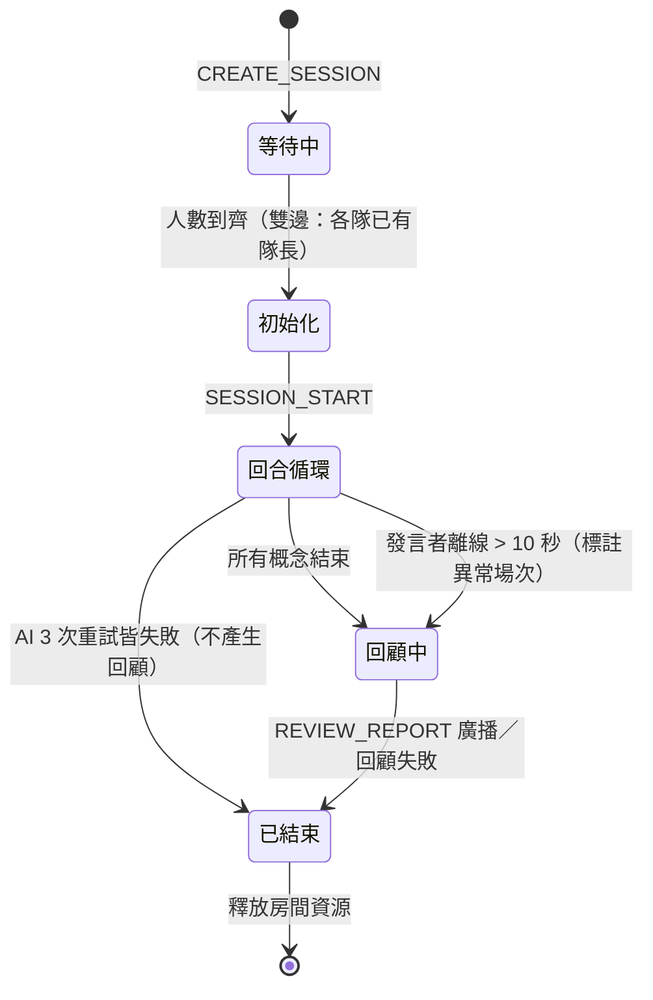
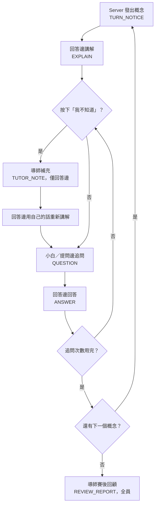

# 費曼 × 哈柏露塔 協作學習系統 PRD

> 版本：v1（2026-10-08）· 作者：@Hong
> 分工：Server（後端）@Hong；Client（前端）另一位組員

## 目錄

1. [產品概述](#1-產品概述)
2. [目標與非目標](#2-目標與非目標)
3. [使用者與使用情境](#3-使用者與使用情境)
4. [角色與出場規則](#4-角色與出場規則)
5. [模式規格](#5-模式規格)
6. [場次設定](#6-場次設定)
7. [功能需求](#7-功能需求)
8. [流程與狀態機](#8-流程與狀態機)
9. [通訊協定](#9-通訊協定)
10. [非功能需求與異常處理](#10-非功能需求與異常處理)
11. [風險與取捨](#11-風險與取捨)
12. [開發分層與里程碑](#12-開發分層與里程碑)
13. [驗收標準](#13-驗收標準)
14. [書面報告對照](#14-書面報告對照)
15. [待決事項](#15-待決事項)

---

## 1. 產品概述

本系統是以**費曼學習法**與**哈柏露塔學習法**為核心的即時多人學習平台：學習者用自己的話講解概念，由夥伴或 AI 追問；AI 導師只在學習者明確求救時補充，並在整場結束後回顧錯誤。

本專案為網路程式設計期末專題，兩人一組，以 Python 實作 Server 與 Client 兩個模組，Client 採圖形化介面。

| 比較項目 | Kahoot | 直接用 ChatGPT 學習 | 本系統 |
| --- | --- | --- | --- |
| 學習者的動作 | 選擇答案 | 與 AI 對話提問 | 用自己的話講解，並被追問 |
| 糾錯時機 | 每題結束顯示對錯 | 隨時由 AI 回應 | 求救時補充，其餘留到賽後回顧 |
| 多人互動 | 搶答與排名 | 無 | 分隊、輪流講解與提問 |
| AI 的角色 | 無 | 單一對話對象 | 導師（求救與賽後）、小白（僅單邊模式） |

## 2. 目標與非目標

第一版要在單邊與雙邊兩種模式下，完整跑通「講解 → 追問 → 求救 → 賽後回顧」的流程，並同時滿足課程對 Server 與 Client 的基本要求。

### 目標

- **G1**：實作單邊與雙邊兩種模式，涵蓋費曼的講解與哈柏露塔的互相提問。
- **G2**：AI 導師只有兩個入口——使用者明確求救、整場結束後的回顧。
- **G3**：題數、追問次數、導師補充字數由場次建立者在建立前設定。
- **G4**：Server 負責帳號、配對、發言權控制、訊息轉送、場次狀態維護與異常離線偵測。
- **G5**：AI 呼叫逾時時重試並提示使用者；3 次皆失敗則通知使用者並結束場次，不讓場次卡死。

### 非目標（第一版不做）

- 語音輸入與語音講解。
- AI 自動評分講解品質；雙邊模式的評斷由提問邊人工判斷。
- 過程中的即時糾錯；使用者答錯但未求救時，AI 不介入。
- 內建的教材與題目編輯器。
- 計分與排名；雙邊模式只記錄提問邊「接受／不接受」。

## 3. 使用者與使用情境

系統有兩種使用者：**場次建立者**與**參與者**（建立者也是參與者之一）。建立者在建立場次前設定參數並邀請其他人加入。

| 情境 | 組成 | 模式 | AI 角色 |
| --- | --- | --- | --- |
| 單人自學 | 1 位使用者 | 單邊 | 導師、小白 |
| 同隊多人 | 多位使用者在同一邊 | 單邊 | 導師、小白 |
| 兩隊對戰 | 使用者分成兩隊 | 雙邊 | 僅導師 |

## 4. 角色與出場規則

AI 導師只在**回答邊成員按下「我不知道」**或**整場結束**時出場；使用者答錯但沒有求救時，AI 一律不介入，流程照常進行。

| 項目 | AI 導師 | AI 小白 |
| --- | --- | --- |
| 職責 | 求救時補充；賽後回顧並補充 | 聽完講解後追問，逼使用者說人話 |
| 適用模式 | 單邊、雙邊 | 僅單邊 |
| 觸發條件 | 回答邊成員按下「我不知道」，或整場結束 | 講解者送出講解 |
| 可存取資訊 | 教材、完整對話紀錄 | 只看到當下的講解內容 |
| 輸出限制 | 求救補充 ≤「導師補充字數」；賽後回顧不限長度，但格式固定 | 每個概念追問 ≤「追問次數」 |
| 禁止事項 | 教材沒提到的內容不得斷言 | 不得陳述事實或評論對錯，只能問「為什麼」「那是什麼意思」「舉個例子」 |

補充說明：

- 小白看不到教材與導師的內容，才能維持「什麼都不懂的外行人」設定，也避免在導師刻意沉默時洩漏答案。
- **可見範圍**：導師的求救補充只送給回答邊，提問邊看不到；賽後回顧送給所有成員。
- 建立者可選擇讓 AI 在建立場次時根據教材生成概念。這發生在場次開始之前，**不屬於**導師在學習過程中的出場。

## 5. 模式規格

- **回答邊**：負責講解與回答。
- **提問邊**：負責提問。
- 單邊模式中，使用者這一邊就是回答邊，由 AI 小白擔任提問者；雙邊模式由兩隊輪流擔任回答邊與提問邊，AI 只當導師。

### 5.1 單邊模式（單人或同隊多人）

1. Server 依「題數」依序發出概念。
2. 同隊任何成員都可以講解與回答，沒有固定順序。
3. AI 小白追問，最多「追問次數」次，回答邊成員逐一回答；追問次數用完，該概念結束。
4. 回答邊任何成員隨時可按「我不知道」，導師補充只有回答邊看得到（見[求救流程](#81-求救流程)）。
5. 所有概念結束後，導師做賽後回顧。

### 5.2 雙邊模式（兩隊）

1. Server 發出概念，指定本回合的回答邊與提問邊，下一回合互換。
2. 回答邊任何成員都可以講解，沒有固定順序。
3. 提問邊成員向回答邊提問，回答邊成員回答；提問輪數上限為「追問次數」。
4. 回答邊任何成員可按「我不知道」；導師補充只有回答邊看得到，所以回答邊仍須**用自己的話重新講解一次**。答錯但未求救時，AI 不介入。
5. 提問邊成員各自判斷本次講解是否接受；多位成員時以**多數決**為準，**平手由隊長決定**。Server 廣播結果並記錄，不計分。
6. 所有概念結束後，導師做賽後回顧。

> 雙邊模式中 AI 不評斷對錯，評斷權完全在提問邊；若提問邊接受了錯誤的解釋，會在賽後回顧中被指出。

## 6. 場次設定

場次建立者在建立場次前必須完成下列設定；**場次建立後設定鎖定**。

### 6.1 數值參數

| 參數 | 說明 | 適用模式 | 預設值 | 範圍 |
| --- | --- | --- | --- | --- |
| 題數 | 本場的概念數量；輸入數量後，介面產生對應數量的概念輸入格 | 單邊、雙邊 | 5 | 1 ~ 10 |
| 追問次數 | 每個概念最多追問次數；單邊由 AI 小白追問，雙邊由提問邊提問 | 單邊、雙邊 | 3 | 1 ~ 5 |
| 導師補充字數 | 導師每次求救補充的字數上限 | 單邊、雙邊 | 150 字 | 50 ~ 300 字 |

### 6.2 其他設定

- **模式**：單邊或雙邊。
- **隊伍分配**（雙邊）：每位參與者所屬的隊伍。開始前每隊須有一位隊員自願擔任隊長（多人同時自願時，以 Server 先收到者為準）；評斷平手時由隊長決定。
- **教材**：由建立者提供，可貼上文字或上傳 PDF（上限 20 MB），作為導師補充與賽後回顧的依據。
  - PDF 文字擷取失敗 → 無法建立場次，顯示「檔案掃描失敗」。
  - 教材文字超過模型可處理長度 → 無法建立場次並顯示錯誤。
- **概念**：輸入概念數量後，介面產生對應數量的輸入格。
  - 可自行填寫，或選擇由 AI 根據教材生成並填入，建立者可檢視與修改。
  - 輸入格不可留空，全部填寫後才能建立場次。
  - 生成發生在場次開始之前，不屬於導師的出場。

## 7. 功能需求

系統分為 Server、Client、AI 模組三部分，前兩者逐項對應課程規定的基本功能。

### 7.1 Server

| 編號 | 需求 | 對應課程要求 |
| --- | --- | --- |
| S1 | 管理成員註冊、登入、離開 | Server 1 |
| S2 | 建立場次並套用參數；建立前驗證教材（PDF 上限 20 MB，文字擷取失敗或超過模型可處理長度則拒絕建立並回報）；讓登入成員知道還缺幾人才能開始 | Server 2 |
| S3 | 初始化場次：分隊、確認各隊都有隊長（雙邊）、決定兩邊的回合順序、載入概念、擷取教材文字（貼上的文字或 PDF） | Server 3 |
| S4 | 擔任仲裁者並控制動作：通知哪一邊該動作，拒絕非該邊成員的送出；提問邊多位成員時統計評斷，多數決為準，平手由隊長決定 | Server 4、5 |
| S5 | 轉送講解、提問、回答與評斷給同場次成員；導師的求救補充只轉送給回答邊 | Server 6 |
| S6 | 維護各場次資訊：場次數量、成員、隊伍、目前階段 | Server 7 |
| S7 | 偵測並處理 Client 異常離線 | Server 8 |
| S8 | 記錄完整對話紀錄，供賽後回顧使用 | 專案需求 |
| S9 | 以非同步方式呼叫 AI 模組，等待 AI 時不阻塞其他場次 | 專案需求 |

### 7.2 Client

| 編號 | 需求 | 對應課程要求 |
| --- | --- | --- |
| C1 | 以圖形化介面呈現 | Client 1 |
| C2 | 註冊、登入、離開介面 | Client 2 |
| C3 | 建立場次介面（題數、追問次數、導師字數；教材貼上或上傳 PDF；依概念數量產生輸入格，或由 AI 生成並可檢視、修改）與加入場次介面（雙邊含自願擔任隊長） | 專案需求 |
| C4 | 接收並顯示其他成員與 AI 的訊息，包含 AI 重新呼叫的提示 | Client 3 |
| C5 | 合法性檢查：只有回答邊能送出講解與回答；只有提問邊能提問與評斷 | Client 4 |
| C6 | 「我不知道」按鈕（僅回答邊），以及提問邊的接受／不接受評斷介面 | 專案需求 |
| C7 | 偵測與 Server 連線中斷並提示使用者 | Client 5 |

### 7.3 AI 模組

| 編號 | 需求 |
| --- | --- |
| A1 | 小白追問，僅單邊模式呼叫 |
| A2 | 導師補充，由求救觸發 |
| A3 | 導師賽後回顧，整場呼叫一次 |
| A4 | 逾時時重試最多 3 次並提示使用者；3 次皆失敗則通知使用者並結束場次 |
| A5 | API 金鑰只存在 Server，Client 不直接呼叫 AI |
| A6 | 根據教材生成概念，僅在建立者選擇由 AI 生成時呼叫 |

### 7.4 AI 模組對 Server 的介面

AI 模組對 Server 只暴露四個函式：

| 函式 | 輸入 | 輸出 | 呼叫時機 |
| --- | --- | --- | --- |
| `generate_concepts` | 教材、題數 | 概念清單 | 建立者選擇由 AI 生成時 |
| `ask_followup` | 當次講解、已追問次數 | 一個追問 | 單邊模式，講解／回答送出後 |
| `help` | 概念、對話上下文、字數上限 | 補充內容 | 回答邊按下「我不知道」 |
| `review` | 完整對話紀錄、教材 | 回顧報告 | 整場結束 |

## 8. 流程與狀態機

一個場次依序經過 **等待 → 初始化 → 回合循環 → 賽後回顧**，Server 在每個階段決定誰能動作；求救與賽後回顧是 AI 導師僅有的兩個入口。

### 回合循環

單邊模式的回合循環如下（2 個判斷、2 處導師出場）；雙邊模式相同，只是追問者換成對隊，且概念結束前多一步提問邊評斷（JUDGE）。

### 8.1 求救流程

1. 回答邊任一成員按下「我不知道」，Client 送出 `HELP_REQUEST`。
2. Server 暫停計時，非同步呼叫導師。
3. 導師依教材補充，字數不超過設定上限；Server 只把補充傳給回答邊，提問邊看不到。
4. Server 恢復計時，回答邊用自己的話重新講解一次，讓提問邊聽到完整的講解。

### 8.2 賽後回顧流程

1. 最後一個概念結束，或場次因發言者離線超過 10 秒而結束，Server 將場次切到「回顧中」；後者的回顧報告標註為**異常場次**。
2. Server 把完整對話紀錄與教材交給導師；紀錄每筆含：發言者、隊伍、內容、時間、所屬概念、是否求救。
3. 導師依固定格式輸出：依概念分段，列出**講錯的地方、正確說法、補充**，長度不限；Server 把回顧報告廣播給所有成員。
4. 場次結束，Server 釋放房間資源。

## 9. 通訊協定

> 以下為訊息類型草案。

**設計原則**

- AI 角色發出的訊息與真人使用同一種格式，只在寄件者欄位標示為 AI，Server 的轉送邏輯因此不必區分對象。
- **封包格式**：每則訊息為 JSON，前面加固定長度的長度欄位，用來處理 TCP 的訊息邊界問題。
- **PDF 教材**（上限 20 MB）：Client 將檔案分段傳送，Server 收齊後擷取文字；擷取失敗或教材過長則拒絕建立場次並回傳錯誤。

| 訊息類型 | 方向 | 用途 | 主要欄位 |
| --- | --- | --- | --- |
| `REGISTER`、`LOGIN`、`LOGOUT` | Client → Server | 註冊、登入、離開 | 帳號、密碼 |
| `CREATE_SESSION` | Client → Server | 建立場次 | 模式、題數、追問次數、導師字數、教材（文字或 PDF）、概念清單或由 AI 生成 |
| `JOIN_SESSION` | Client → Server | 加入場次並選隊 | 場次代號、隊伍 |
| `CAPTAIN_VOLUNTEER` | Client → Server → 成員 | 隊員自願擔任隊長（雙邊） | 隊伍、隊長 |
| `LOBBY_STATUS` | Server → Client | 告知目前人數與尚缺人數 | 已加入人數、尚缺人數 |
| `SESSION_START` | Server → Client | 場次開始 | 概念清單、隊伍、發言順序 |
| `TURN_NOTICE` | Server → Client | 通知哪一邊該做什麼 | 概念、輪到的一邊、剩餘時間 |
| `EXPLAIN` | Client → Server → 成員 | 講解 | 概念、內容 |
| `QUESTION` | Client 或 AI → Server → 成員 | 提問或追問 | 概念、內容、寄件者 |
| `ANSWER` | Client → Server → 成員 | 回答提問 | 概念、內容 |
| `HELP_REQUEST` | Client → Server | 按下「我不知道」 | 概念 |
| `TUTOR_NOTE` | Server → 回答邊 | 導師求救補充，僅回答邊可見 | 概念、內容 |
| `JUDGE` | Client → Server → 成員 | 提問邊評斷 | 概念、接受或不接受 |
| `REVIEW_REPORT` | Server → Client | 賽後回顧 | 是否異常場次；依概念分段：講錯的地方、正確說法、補充 |
| `AI_STATUS` | Server → Client | 通知 AI 正在重新呼叫，或 AI 異常 | 重試次數、狀態 |
| `HEARTBEAT` | 雙向 | 偵測連線狀態 | 時間戳 |
| `PEER_DISCONNECTED` | Server → Client | 通知成員離線 | 使用者、處理方式 |
| `ERROR` | Server → Client | 拒絕非法動作 | 錯誤碼、說明 |

## 10. 非功能需求與異常處理

原則：任何 AI 或連線異常都不能讓場次卡死，每種失敗都要有明確的處理方式。

| 項目 | 需求 |
| --- | --- |
| 不阻塞 | AI 呼叫在獨立執行緒或佇列中處理，等待期間 Server 仍處理其他訊息，Client 顯示 AI 處理中 |
| 逾時 | 追問與導師補充 20 秒；概念生成與賽後回顧 60 秒；每次重試重新計時。最多重試 3 次，每次重試都在介面提示使用者；3 次皆失敗則通知 AI 異常並結束場次（建立場次階段則為無法建立） |
| 導師補充失敗 | 依逾時重試規則；3 次皆失敗則結束場次，不產生賽後回顧，對話紀錄保留 |
| 小白追問失敗 | 依逾時重試規則；3 次皆失敗則結束場次，不產生賽後回顧，對話紀錄保留 |
| 賽後回顧失敗 | 依逾時重試規則；3 次皆失敗則通知使用者 AI 異常，對話紀錄保留 |
| 成員異常離線 | Server 以心跳偵測。**發言者**離線：場次暫停，10 秒內重連則繼續，超過 10 秒則結束場次，仍產生賽後回顧並標註異常場次。**其他成員**離線：通知全場並繼續（預設）。對話紀錄一律保留並納入回顧 |
| Server 連線中斷 | Client 偵測後提示使用者，介面不卡死 |
| 金鑰 | 只存在 Server 端設定，不放進 Client 或版本控制 |
| 多場次 | 多個場次可同時進行，彼此狀態互不影響 |
| AI 成本上界 | 小白追問 ≤ 題數 × 追問次數；導師補充 = 求救次數；賽後回顧 1 次 |

## 11. 風險與取捨

最大的取捨是**刻意延遲糾錯**：換來學習者自己面對落差的機會，代價是錯誤觀念會留到賽後才被指出。

| 風險 | 影響 | 對策 |
| --- | --- | --- |
| 導師講錯 | 學習者學到錯誤觀念 | 導師只依教材補充，教材沒提到的內容標示為不確定 |
| 延遲糾錯 | 錯誤觀念在過程中延續到賽後 | 屬刻意設計；報告中誠實說明這個取捨 |
| 雙邊評斷不準 | 提問邊可能接受錯誤的解釋 | 賽後回顧指出被接受的錯誤解釋 |
| 現場網路與 API 額度 | demo 時 AI 無法使用 | 依異常處理規則重試，3 次皆失敗則結束場次；採用雲端 LLM API |
| 範圍過大 | 期末前做不完 | 依開發分層進行，第一層不含 AI 也能 demo |

## 12. 開發分層與里程碑

開發分三層，第一層完全不依賴 AI；即使後兩層來不及，仍是符合課程要求、可 demo 的作品。

| 層級 | 內容 | 完成標準 |
| --- | --- | --- |
| 第一層（必做） | 雙邊模式（真人互相提問）、帳號、場次建立與參數設定、提問邊評斷、斷線處理、完整對話紀錄 | 兩隊真人可完整跑完一場，不需要 AI |
| 第二層 | 教材載入（貼上文字與 PDF）、AI 概念生成、AI 導師（求救補充、賽後回顧）、逾時重試與異常結束 | 求救與賽後回顧皆可運作，AI 失敗時流程不中斷 |
| 第三層 | 單邊模式與 AI 小白 | 單人與同隊多人可完成一場，追問次數受設定限制 |

### 分工

| 成員 | 負責範圍 |
| --- | --- |
| 後端（@Hong） | Server：場次狀態機、通訊協定、發言權控制、AI 模組介面 |
| 前端 | Client 圖形介面、教材內容與 AI 提示詞，並負責整合測試 |

## 13. 驗收標準

下列十二項全部通過，才算完成第一版的設計目標。

| 編號 | 驗收項目 |
| --- | --- |
| AC1 | 建立場次時可設定題數、追問次數、導師補充字數，場次開始後設定不可更改 |
| AC2 | 使用者未按「我不知道」時，不論答案對錯，AI 導師都不出現 |
| AC3 | 按下「我不知道」後，導師補充不超過設定的字數上限，且只有回答邊看得到 |
| AC4 | 每個概念的追問不超過設定的追問次數；雙邊模式不出現 AI 小白 |
| AC5 | 雙邊模式中只有提問邊能送出評斷，結果廣播給全場 |
| AC6 | 賽後回顧涵蓋全場講錯的地方，並附上補充，輸出格式固定 |
| AC7 | AI 呼叫逾時時最多重試 3 次並提示使用者；3 次皆失敗則通知使用者 AI 異常並結束場次 |
| AC8 | 發言者異常離線時，Server 偵測並暫停場次，超過 10 秒未恢復則結束場次，仍產生賽後回顧並標註異常場次，對話紀錄保留 |
| AC9 | 等待 AI 回應時，Server 仍能處理其他場次的訊息 |
| AC10 | 教材 PDF 超過 20 MB 時拒絕上傳；文字擷取失敗時無法建立場次並顯示「檔案掃描失敗」；教材文字超過模型可處理長度時同樣無法建立場次並顯示錯誤 |
| AC11 | 建立者輸入概念數量後，介面產生對應數量的輸入格；可自行填寫，或由 AI 根據教材生成並填入，建立者可檢視與修改；輸入格不可留空，全部填寫後才能建立場次 |
| AC12 | 雙邊模式開始前每隊須有一位隊員自願擔任隊長；提問邊評斷出現多數決平手時，由隊長決定 |

## 14. 書面報告對照

| 報告章節 | 對應 PRD 內容 |
| --- | --- |
| 簡介 | 產品概述、目標與非目標、開發分層（含人力分配與時程） |
| 文獻 | Kahoot 等現有作品與兩種學習法（需另外蒐集），與產品概述的比較表呼應 |
| 方法 | 功能需求（子模組）、流程與狀態機、通訊協定（循序圖依訊息類型繪製） |
| 成果、結論、參考文獻 | 完成開發後填寫 |

## 15. 待決事項

目前沒有待決事項；所有設計問題已在內文定案。
