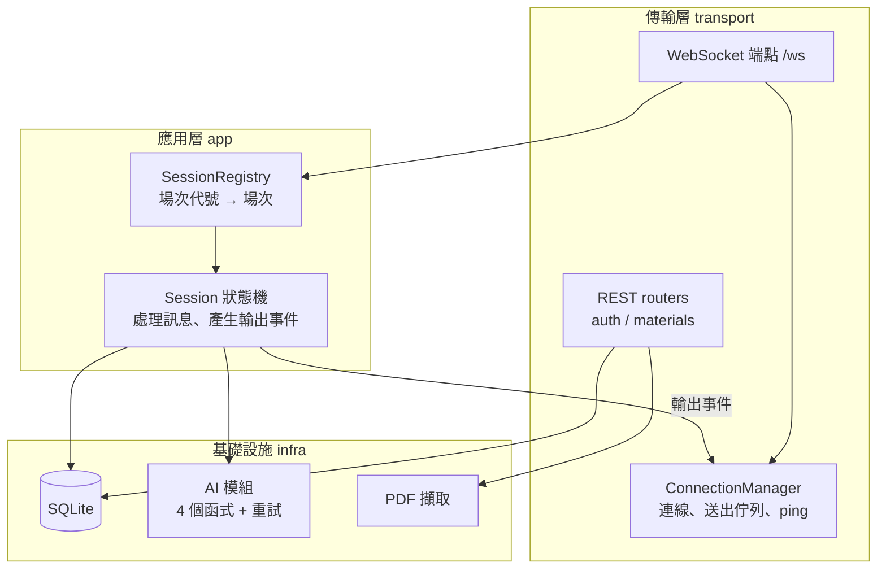

# 後端開發文件

> 對應 PRD：[PRD.md](PRD.md) v1.3 · 建立日期：2026-10-17 · 負責人：@Hong
> 本文件說明後端**要做什麼、怎麼切、照什麼順序做、做到什麼程度算完成**。需求細節以 PRD 為準，兩者衝突時先改 PRD。

## 目錄

1. [範圍](#1-範圍)
2. [技術選型](#2-技術選型)
3. [架構](#3-架構)
4. [目錄結構](#4-目錄結構)
5. [模組職責](#5-模組職責)
6. [資料模型](#6-資料模型)
7. [場次狀態機實作要點](#7-場次狀態機實作要點)
8. [錯誤碼](#8-錯誤碼)
9. [關鍵流程的實作注意事項](#9-關鍵流程的實作注意事項)
   - [9.6 呼叫 Claude API](#96-呼叫-claude-api)
   - [9.7 撰寫提示詞](#97-撰寫提示詞)
10. [開發里程碑與任務清單](#10-開發里程碑與任務清單)
11. [測試策略](#11-測試策略)
12. [與前端協作](#12-與前端協作)
13. [FastAPI 開發注意事項](#13-fastapi-開發注意事項)
14. [開工前待確認](#14-開工前待確認)

---

## 1. 範圍

後端負責 PRD §7.1 的 S1～S9，以及 §7.3 的 AI 模組中**呼叫、逾時、重試、字數截斷、格式驗證**的部分。四個 AI 函式的提示詞也由後端撰寫（PRD §12，v1.3 調整）。

| 後端負責 | 後端不負責 |
| --- | --- |
| REST API 與 WebSocket 端點 | Client 圖形介面 |
| 帳號、token、SQLite | 教材內容 |
| 場次管理與狀態機、發言權控制 | 整合測試的主導（後端配合） |
| 訊息轉送與可見範圍過濾 | |
| 離線偵測、暫停、重連 | |
| AI 呼叫、逾時、重試、截斷、JSON 驗證 | |
| 對話紀錄保存 | |
| AI 提示詞（§9.7） | |

## 2. 技術選型

| 用途 | 套件 | 備註 |
| --- | --- | --- |
| Python | 3.13 | 與目前環境一致 |
| Web 框架 | `fastapi` | REST + WebSocket |
| ASGI 伺服器 | `uvicorn[standard]` | 含 WebSocket 支援；**只開 1 個 worker** |
| 資料驗證 | `pydantic`（FastAPI 內建） | 訊息與 REST 請求的 schema |
| 檔案上傳 | `python-multipart` | `UploadFile` 需要 |
| PDF 文字擷取 | `pypdf` | 阻塞操作，需放到 `asyncio.to_thread` |
| 資料庫 | `sqlite3`（標準庫）或 `aiosqlite` | 用 `sqlite3` 時需包在 `asyncio.to_thread` |
| 密碼雜湊 | `bcrypt` 或標準庫 `hashlib.pbkdf2_hmac` | 阻塞操作 |
| 設定 | `python-dotenv` 或 `pydantic-settings` | 讀 `.env`（已在 `.gitignore`） |
| LLM | `anthropic`（官方 Python SDK） | 使用 `AsyncAnthropic`；模型 `claude-sonnet-5-5`（Claude Sonnet 5.5），見 §9.6 |
| 測試 | `pytest`、`pytest-asyncio`、`httpx` | FastAPI `TestClient` 可測 WebSocket |

建議用 `requirements.txt` 或 `pyproject.toml` 鎖定版本，並建立虛擬環境（`.venv` 要加進 `.gitignore`）。

## 3. 架構

分四層，**場次邏輯不依賴 FastAPI**。這樣做有兩個好處：狀態機可以不開伺服器就單獨測試；如果老師不接受 Web 框架（PRD §15），只要換掉傳輸層即可。



**核心原則：狀態機只回傳「要送給誰、送什麼」的事件清單，自己不碰 WebSocket。**傳輸層拿到事件清單後，依對象（全場、回答邊、提問邊、某位使用者）放進各連線的送出佇列。這樣「導師補充只給回答邊」這類規則，在狀態機的單元測試裡就能驗證。

## 4. 目錄結構

建議如下（名稱可自行調整）：

```text
backend/
├── main.py                 # 建立 FastAPI app、lifespan（初始化 DB）、掛上 routers
├── config.py               # 讀 .env：API 金鑰、模型名稱、逾時秒數、上限值
├── db.py                   # SQLite 連線與資料表建立、各種存取函式
├── auth/
│   ├── router.py           # /auth/register、/auth/login、/auth/logout
│   └── tokens.py           # token 產生、查詢、失效（記憶體）
├── materials/
│   ├── router.py           # /materials、/materials/pdf
│   └── extract.py          # PDF 擷取、長度檢查
├── realtime/
│   ├── ws.py               # /ws 端點：AUTH、收訊息、分派
│   ├── connections.py      # ConnectionManager：使用者 ↔ 連線、送出佇列
│   └── protocol.py         # 各訊息類型的 pydantic schema、錯誤碼
├── session/
│   ├── registry.py         # 場次代號產生、場次查找、使用者 → 場次
│   ├── models.py           # Session、Member、Settings 等資料結構
│   ├── machine.py          # 狀態機：依階段處理訊息、回傳輸出事件
│   └── review.py           # 組對話紀錄給 review、驗證回顧 JSON
├── ai/
│   ├── client.py           # LLM 呼叫、逾時、重試（總共 3 次）
│   ├── tutor.py            # help、review、generate_concepts
│   ├── novice.py           # ask_followup（小白）
│   ├── fake.py             # 測試用假 AI：可設定延遲與失敗次數
│   └── prompts/            # 提示詞檔案，每個 AI 函式一份（見 §9.7）
└── tests/
```

## 5. 模組職責

| 模組 | 職責 | 對應 PRD |
| --- | --- | --- |
| `config` | 集中所有可調參數：AI 逾時（20／60 秒）、重試次數 3、教材上限 100,000 字元、PDF 20 MB、離線寬限 10 秒、WebSocket 認證逾時 5 秒、單則訊息 1 MB | §6、§10 |
| `auth` | 註冊（檢查重複帳號、雜湊密碼）、登入（驗證、發 token、踢掉同帳號舊連線）、登出（token 失效，若在場次中視同離開） | S1 |
| `materials` | 接收文字或 PDF、檢查大小、擷取文字、檢查長度、存 DB、回 `material_id` | S2、AC10 |
| `realtime/ws` | 接受連線、5 秒內要求 `AUTH`、以 pydantic 驗證每則訊息、分派到場次或回 `ERROR` | S4、S5 |
| `realtime/connections` | 維護「使用者 → 連線」；每條連線一個送出佇列與送出 task；斷線時通知場次 | S5、S7 |
| `session/registry` | 產生不重複的場次代號；維護「使用者 → 所在場次」，確保一人只在一個場次；場次結束後移除 | S2、S6 |
| `session/machine` | PRD §8 的所有規則：誰能在什麼階段送什麼、追問計數、投票統計、求救、暫停與恢復、結束條件 | S3、S4、§5、§8 |
| `session/review` | 從 DB 取出完整對話紀錄、呼叫 `review`、驗證 JSON schema、加上 `abnormal` 標記 | S8、§8.2 |
| `ai/client` | 建立唯一的 `AsyncAnthropic` client；單次呼叫逾時、可重試錯誤分類、每次重試前回報 `AI_STATUS`、3 次失敗丟出例外（細節見 §9.6） | A4、§10 |
| `ai/tutor`、`ai/novice` | PRD §7.4 的四個函式；`help` 結果超過字數上限時截斷 | A1～A3、A6、AC3 |

## 6. 資料模型

### 6.1 記憶體中的狀態

| 物件 | 主要欄位 |
| --- | --- |
| Token 表 | token → 使用者名稱；使用者名稱 → 目前 token |
| 連線 | 使用者、WebSocket、送出佇列、是否已認證 |
| Session | 場次代號、設定（模式、題數、追問次數、導師字數、人數、先答隊伍）、`material_id`、概念清單、建立者、成員與隊伍、隊長、狀態（等待中／回合循環／暫停／回顧中／已結束）、目前概念索引、目前階段、本概念已追問次數、本階段是否已收到發言、本輪是否已收到提問、評斷票、目前 AI 請求編號、暫停前的階段、離線寬限 task、`asyncio.Lock` |

### 6.2 SQLite 資料表

| 資料表 | 欄位 | 用途 |
| --- | --- | --- |
| `users` | `username`（PK）、`password_hash`、`created_at` | 帳號 |
| `materials` | `id`（PK）、`owner`、`source`（text／pdf）、`content`、`length`、`created_at` | 教材文字 |
| `sessions` | `id`（PK）、`code`、`mode`、`settings_json`、`material_id`、`concepts_json`、`status`、`end_reason`、`abnormal`、`created_at`、`ended_at` | 場次紀錄 |
| `messages` | `id`（PK）、`session_id`、`concept_index`、`type`、`sender`、`team`、`content`、`after_help`、`created_at` | 完整對話紀錄（PRD §8.2 第 2 點的欄位） |
| `judgments` | `session_id`、`concept_index`、`result`、`accept_votes`、`reject_votes`、`by_captain` | 評斷結果 |
| `reviews` | `session_id`、`report_json` | 賽後回顧報告 |

`messages` 要記錄所有發言，包括 AI 小白的追問與導師補充，回顧時才能完整重建對話。

## 7. 場次狀態機實作要點

### 7.1 處理一則訊息的固定順序

1. 依 `type` 驗證 payload 格式，不合格 → `ERROR`（`INVALID_MESSAGE`）。
2. 確認使用者在這個場次中，且場次不是暫停或已結束。
3. 確認目前階段允許這種訊息（PRD §8「回合階段」表）。
4. 確認發送者屬於該階段可動作的一邊（回答邊／提問邊／隊長）。
5. 確認階段內的額外條件，例如 `TURN_DONE` 前至少要有一則發言、`QUESTION` 本輪尚未收過、`JUDGE` 每人只能投一票。
6. 更新狀態、寫入 DB、回傳輸出事件。

第 2～5 步任一不符，回 `ERROR` 並且**不改變任何狀態**。

### 7.2 階段轉換

| 目前階段 | 觸發 | 下一階段 |
| --- | --- | --- |
| `EXPLAIN` | `TURN_DONE` | 追問次數已用完 → 概念結束（雙邊先到 `JUDGE`）；否則單邊 `AI_PENDING`（呼叫小白），雙邊 `QUESTION` |
| `QUESTION`（雙邊） | `QUESTION` | `ANSWER`，已追問次數 +1 |
| `QUESTION`（雙邊） | `END_QUESTIONS` | `JUDGE` |
| `AI_PENDING`（小白） | 回傳追問 | `ANSWER`，已追問次數 +1 |
| `AI_PENDING`（小白） | 回傳「結束」 | 概念結束 |
| `ANSWER` | `TURN_DONE` | 追問次數用完 → 概念結束（雙邊先到 `JUDGE`）；否則同 `EXPLAIN` 完成後的處理 |
| `EXPLAIN`／`ANSWER` | `HELP_REQUEST` | `AI_PENDING`（呼叫導師） |
| `AI_PENDING`（導師） | 回傳補充 | `EXPLAIN`（重新講解），追問次數不變 |
| `JUDGE` | 提問邊全員投完 | 多數 → 概念結束；平手 → `TIEBREAK` |
| `TIEBREAK` | 隊長 `JUDGE` | 概念結束 |
| 概念結束 | — | 還有概念 → 下一概念 `EXPLAIN`（雙邊交換兩邊）；否則回顧中 |
| 任何階段 | 任一成員斷線 | 暫停（記住原階段） |
| 暫停 | 10 秒內重連 | 回到原階段 |
| 暫停 | 超過 10 秒 | 回顧中（`abnormal = true`） |

每次轉換後都要廣播 `TURN_NOTICE`。

## 8. 錯誤碼

建議先定下面這份，前端依錯誤碼顯示訊息。REST 錯誤也使用同一套錯誤碼。

| 錯誤碼 | 意義 |
| --- | --- |
| `INVALID_MESSAGE` | 訊息格式錯誤或欄位缺漏 |
| `UNAUTHORIZED` | 未認證或 token 失效 |
| `USERNAME_TAKEN` | 帳號已存在 |
| `BAD_CREDENTIALS` | 帳密錯誤 |
| `FILE_TOO_LARGE` | PDF 超過 20 MB |
| `PDF_EXTRACT_FAILED` | 檔案掃描失敗 |
| `MATERIAL_TOO_LONG` | 教材超過 100,000 字元 |
| `INVALID_SETTINGS` | 參數超出範圍、概念數量不符或有空白 |
| `SESSION_NOT_FOUND` | 場次代號不存在 |
| `ALREADY_IN_SESSION` | 已在其他場次中 |
| `TEAM_FULL` | 選擇的隊伍已滿 |
| `CAPTAIN_TAKEN` | 該隊已有隊長 |
| `NOT_READY` | 人數未到齊或缺隊長，無法開始 |
| `NOT_CREATOR` | 只有建立者能執行 |
| `WRONG_PHASE` | 目前階段不允許這個動作 |
| `NOT_YOUR_TURN` | 不是可動作的一邊 |
| `ALREADY_VOTED` | 已投過票 |
| `NOTHING_TO_SUBMIT` | 尚未發言就按「完成」 |
| `SESSION_PAUSED` | 場次暫停中 |
| `AI_UNAVAILABLE` | AI 3 次皆失敗 |

## 9. 關鍵流程的實作注意事項

### 9.1 呼叫 AI（最容易出錯的地方）

1. 取場次 lock → 切到 `AI_PENDING`、記下這次的 **AI 請求編號** → 放開 lock → 廣播 `AI_STATUS`。
2. 不持有 lock 的情況下，用 `asyncio.create_task` 呼叫 AI，讓 WebSocket 接收迴圈繼續處理其他訊息。
3. AI 回應後重新取 lock，**檢查場次仍在 `AI_PENDING` 且請求編號相符**，才套用結果；不符就丟棄（例如場次已因離線而結束）。
4. 場次暫停中收到回應 → 先存起來，恢復時再送出（PRD §10）。
5. 3 次皆失敗 → 依 PRD §10 結束場次或通知異常。

**驗收重點**：AC7（重試提示）、AC9（等待 AI 時其他場次照常運作）。

### 9.2 斷線、暫停、重連

- WebSocket 接收迴圈因斷線結束時（`WebSocketDisconnect`，或 ping 逾時導致的連線關閉），通知 ConnectionManager 移除連線，再通知所在場次。
- 場次在大廳：一般成員移出並更新 `LOBBY_STATUS`；建立者離開則解散場次（`SESSION_END`）。
- 場次進行中：切到暫停、廣播 `SESSION_PAUSED` 與 `PEER_DISCONNECTED`、建立 10 秒寬限 task。
- 同一使用者 `AUTH` 成功時，若有寬限 task 就取消，廣播 `PEER_RECONNECTED`；若所有離線者都已回來，就恢復場次、廣播 `SESSION_RESUMED`，並對重連者送 `SESSION_SYNC`。
- 寬限 task 到期：結束場次，`abnormal = true`，進入賽後回顧。
- 多人同時斷線時，每人各自一個寬限 task，**全部回來才恢復**。

**驗收重點**：AC8。

### 9.3 同帳號重複登入

`POST /auth/login` 成功時，如果該帳號已有 token：讓舊 token 失效，對舊連線送 `KICKED` 後關閉。被踢的連線**不算離線**，不觸發暫停；新連線完成 `AUTH` 後送 `SESSION_SYNC`。

### 9.4 導師補充只給回答邊

狀態機輸出 `TUTOR_NOTE` 事件時，對象指定為「回答邊」，由傳輸層展開成具體使用者。這條規則一定要寫測試（AC3）。

### 9.5 字數截斷

以字元數（`len()`）判斷是否超過上限，超過就截斷並加上「…」，截斷後的總長也不能超過上限。

### 9.6 呼叫 Claude API

LLM 使用 **Claude Sonnet 5.5**，模型 ID 為 `claude-sonnet-5-5`（不要加日期後綴）。Context window 為 1M tokens，100,000 字元的教材放得下。價格為輸入 $2、輸出 $10（每百萬 tokens），快取讀取 $0.20。

**Client 設定**

- 在 lifespan 建立**一個** `AsyncAnthropic` client 供全程共用，不要每次呼叫都重建。金鑰從 `.env` 的 `ANTHROPIC_API_KEY` 讀取。
- **關閉 SDK 內建重試（`max_retries=0`）**。SDK 預設會自動重試 2 次、逾時 10 分鐘；如果不關掉，PRD 規定的「總共 3 次」實際上會變成最多 9 次，而且 Server 無法在每次重試時送出 `AI_STATUS`。重試一律由 `ai/client` 自己控制。
- 每次呼叫用 `with_options(timeout=...)` 設定逾時：追問與導師補充 20 秒，概念生成與賽後回顧 60 秒。

**錯誤分類**（用 SDK 的例外類別判斷，不要比對錯誤訊息字串）

| 情況 | SDK 例外或回應 | 處理 |
| --- | --- | --- |
| 逾時 | `APITimeoutError` | 重試 |
| 連線錯誤 | `APIConnectionError` | 重試 |
| 流量限制 | `RateLimitError`（429） | 重試 |
| 伺服器錯誤 | `InternalServerError`（5xx） | 重試 |
| 金鑰錯誤、請求格式錯誤 | `AuthenticationError`、`BadRequestError` 等其他 4xx | 不重試，直接視為 AI 異常 |
| 模型拒答 | 回應的 `stop_reason == "refusal"` | 視為該次失敗；讀取 `content` 前一定要先檢查 `stop_reason` |

**模型設定**

- **thinking**：Sonnet 5.5 預設開啟自適應思考。**不要送 `thinking: {type: "disabled"}`**，會回 400。
- **effort**：用 `output_config.effort` 控制思考深度。預設是 `high`，但 20 秒的逾時可能不夠。建議先這樣設定，再實測調整：

  | 函式 | 建議 effort | 原因 |
  | --- | --- | --- |
  | `ask_followup`（小白） | `low` | 問題簡短，逾時只有 20 秒 |
  | `help`（導師補充） | `low` 或 `medium` | 逾時 20 秒，內容要正確 |
  | `generate_concepts` | `medium` | 逾時 60 秒 |
  | `review` | `medium`，實測後視品質調整 | 逾時 60 秒，要讀完整場紀錄 |

- **max_tokens**：思考也會占用輸出 tokens，不要設太小，否則回答會被截斷。非串流呼叫可以先設 16000 左右，`help` 的字數上限由 Server 截斷處理，不要靠 `max_tokens` 控制。
- **不能用 assistant prefill**（在 messages 最後放 assistant 開頭），Sonnet 5.5 會回 400。

**固定格式輸出**

`review` 與 `generate_concepts` 需要固定的 JSON 格式，建議用 SDK 的結構化輸出（`client.messages.parse()` 搭配 pydantic 模型，或 `output_config.format`），由 API 保證輸出符合 schema。這樣可以大幅減少「回顧格式不合 → 重試」的情況。`ask_followup` 需要回傳「追問」或「結束」兩種結果，也適合用結構化輸出。

**省錢：快取教材**

求救不限次數，每次 `help` 都要帶上整份教材（最多約 10 萬 tokens 以上）。建議把教材放在 system prompt 並加上 `cache_control` 啟用 prompt caching：同一場次之後的 `help` 只需付快取讀取的費用（約原價的十分之一）。教材內容要放在每次都相同的前段，會變動的對話上下文放在後面，否則快取無法命中。可以檢查回應的 `usage.cache_read_input_tokens` 確認是否命中。

**拒答時的備援（選用）**

Sonnet 5.5 的安全分類器偶爾會誤判而拒答。Claude API 提供伺服器端備援：加上 beta `server-side-fallback-2026-07-01` 與 `fallbacks: "default"`，遇到拒答時會自動改用其他模型回答。教學內容通常不會觸發拒答，可以視 demo 時的實際情況決定是否開啟。

**寫程式前要讀的文件**

SDK 的實際寫法以官方文件為準，不要憑印象。動手前先看 Anthropic Python SDK 的 README（async client、逾時、錯誤類別），以及 structured outputs 和 prompt caching 的文件。

### 9.7 撰寫提示詞

每個 AI 函式一份提示詞檔案，放在 `ai/prompts/`，與程式碼分開，方便反覆調整。變數（概念、字數上限等）由程式代入；教材與對話紀錄放在固定位置，讓教材可以被快取（§9.6）。

PRD 的角色規則就是提示詞的規格，每份都要涵蓋：

| 檔案 | 角色 | 必須寫進提示詞的規則（出處） | 輸出 |
| --- | --- | --- | --- |
| `novice.md` | AI 小白 | 扮演什麼都不懂的外行人；**看不到教材**；只能問「為什麼」「那是什麼意思」「舉個例子」；**不能陳述事實、不能評論對錯**；不重複問過的問題；判斷已講清楚就結束（PRD §4、§5.2） | 結構化：一個追問，或「結束」 |
| `tutor_help.md` | AI 導師（求救） | 只根據教材補充；教材沒提到的內容標示為不確定、不能斷言；不超過 N 字（Server 仍會截斷）；不要直接替學習者講完整答案，留空間讓他重新講解（PRD §4、§8.1） | 純文字 |
| `tutor_review.md` | AI 導師（賽後回顧） | 依概念分段找出講錯的地方；包含**被提問邊接受的錯誤解釋**；給正確說法與補充；只依教材判斷；沒有講錯的概念也要給一句總結；異常場次只回顧已發生的部分（PRD §5.3、§8.2） | 結構化：§8.2 的 JSON |
| `generate_concepts.md` | 概念生成 | 從教材挑出 N 個適合用自己的話講解的概念；名稱簡短、彼此不重複 | 結構化：概念清單 |

撰寫與驗證的建議：

- 用正面、具體的描述說明角色與規則，並說明**為什麼**（例如「小白看不到教材，是為了逼學習者用自己的話講清楚」），模型會更穩定地遵守。
- 每份提示詞準備 3～5 組測試輸入（含講對、講錯、答非所問、講得很模糊），改提示詞後重跑，確認規則沒有被破壞。重點檢查：小白有沒有偷偷給答案、導師有沒有講出教材以外的內容。
- 提示詞也要 commit 進版本控制；不要把金鑰或真實使用者資料放進提示詞檔案。

## 10. 開發里程碑與任務清單

照 PRD §12 的分層進行。**每個里程碑結束時都要可以 demo**。

### M0：專案骨架

- [ ] 建立虛擬環境、`requirements.txt`，`.gitignore` 加上 `.venv/`
- [ ] `config.py` 讀 `.env`，提供 `.env.example`（不含真實金鑰）
- [ ] `main.py`：lifespan 初始化 SQLite 資料表
- [ ] `/ws` 端點能 accept、收發 JSON、處理斷線
- [ ] 寫一支簡易測試 Client（命令列即可），用來手動測協定

**完成標準**：uvicorn 啟動後，測試 Client 能連上 `/ws` 並收到回應。

### M1：第一層：真人雙邊模式（必做）

- [ ] REST：註冊、登入、登出、token（S1）
- [ ] WebSocket `AUTH`、同帳號踢除
- [ ] ConnectionManager：送出佇列、依對象送出
- [ ] 協定 schema 與錯誤碼（§8）
- [ ] `CREATE_SESSION`（此時可不帶 `material_id`）、`JOIN_SESSION`、選隊、`CAPTAIN_VOLUNTEER`、`LOBBY_STATUS`、`START_SESSION`（S2、S3）
- [ ] 雙邊狀態機：`EXPLAIN` → `QUESTION` ↔ `ANSWER` → `JUDGE`／`TIEBREAK` → 下一概念，兩邊互換（S4）
- [ ] 訊息轉送與 `TURN_NOTICE`（S5）
- [ ] 對話紀錄與評斷寫入 SQLite（S8）
- [ ] 斷線暫停、10 秒寬限、重連與 `SESSION_SYNC`、`LEAVE_SESSION`（S7）
- [ ] 多場次同時進行（S6）
- [ ] 第一層暫時沒有 AI：概念全部結束後直接 `SESSION_END`

**完成標準**：兩隊真人用測試 Client 完整跑完一場；AC1、AC5、AC8（不含回顧）、AC12 通過。

### M2：第二層：教材與 AI 導師

- [ ] `POST /materials`、`POST /materials/pdf`：大小、擷取、長度檢查（AC10）
- [ ] `CREATE_SESSION` 必須帶 `material_id`
- [ ] `ai/client`：`AsyncAnthropic`（`max_retries=0`）、逾時、重試、`AI_STATUS`、錯誤分類、拒答處理（AC7）
- [ ] `ai/fake.py`：可設定延遲與失敗次數，供測試使用
- [ ] `GENERATE_CONCEPTS`，失敗時回 `AI_UNAVAILABLE`（前端改為手動填寫）
- [ ] `HELP_REQUEST` → 導師補充 → 只送回答邊 → 重新講解（AC2、AC3）
- [ ] 提示詞：`tutor_help.md`、`tutor_review.md`、`generate_concepts.md`，並建立測試輸入（§9.7）
- [ ] 賽後回顧：組對話紀錄、呼叫 `review`、驗證 JSON、廣播（AC6）
- [ ] 異常場次的回顧標記（AC8 完整版）
- [ ] 確認等待 AI 時其他場次不受影響（AC9）

**完成標準**：求救與賽後回顧都能運作；用假 AI 模擬失敗時，流程依 PRD §10 正確結束。

### M3：第三層：單邊模式與 AI 小白

- [ ] 單邊模式的建立與開始（人數 1 時可立即開始）
- [ ] 提示詞：`novice.md`，並驗證小白不陳述事實、不評論對錯（§9.7）
- [ ] `TURN_DONE` 後呼叫小白、可提前結束（AC4）
- [ ] 確認雙邊模式不會呼叫小白（AC4）

**完成標準**：單人與同隊多人都能完成一場。

## 11. 測試策略

| 層級 | 測什麼 | 方法 |
| --- | --- | --- |
| 單元測試 | 狀態機每條轉換、每個拒絕條件、投票與平手、追問計數、可見範圍 | 直接呼叫 `session/machine`，不開伺服器 |
| 單元測試 | 重試、逾時、截斷、回顧 JSON 驗證 | 搭配 `ai/fake.py` |
| 整合測試 | 完整一場（雙邊、單邊）、斷線重連、重複登入 | `TestClient.websocket_connect()` 同時開多個連線 |
| 並行測試 | AC9：一個場次等待 AI 時，另一場次的訊息照常處理 | 假 AI 設定延遲 10 秒，量測另一場次的回應時間 |
| 手動驗收 | AC1～AC12 | 每個里程碑結束時，對照 PRD §13 逐項打勾 |

假 AI 是第二、三層的測試關鍵，**建議先寫假 AI 再接真的 LLM**，也能省下 API 費用。

## 12. 與前端協作

後端需要交給前端的東西：

1. **協定文件**：PRD §9 就是共同契約，有任何改動都要先改 PRD、再通知對方。
2. **訊息範例**：每種訊息附一個 JSON 範例（可放在 `docs/protocol-examples.md`），前端照著做最快。
3. **可連線的開發伺服器**：M1 前期就先讓 `/ws` 跑起來，前端可以提早串接。

需要跟前端一起決定或確認的事：

- Client 端的 WebSocket 函式庫要開啟 ping，並且不能在 GUI 主執行緒上收訊息（PRD §10）。
- 錯誤碼對應的顯示文字（§8）。
- `SESSION_SYNC` 的內容是否足夠前端還原畫面。

## 13. FastAPI 開發注意事項

- `async def` 裡**不能**呼叫阻塞的程式（同步 LLM SDK、`time.sleep`、`sqlite3`、`pypdf`、`bcrypt`），否則整個 Server 都會卡住。不確定時就用 `asyncio.to_thread` 包起來。
- 場次狀態放在記憶體，所以 uvicorn **只能開 1 個 worker**。開發時用 `--reload`，每次存檔都會清空所有場次。
- 雖然 asyncio 是單執行緒，但每個 `await` 都可能切到別的工作，改狀態時仍要用 lock 保護，而且**不要拿著 lock 去 `await` AI**。
- 不要讓多個 task 同時對同一個 WebSocket `send`，一律透過送出佇列。
- FastAPI 預設不限制上傳大小，20 MB 的上限要自己檢查。
- Demo 時用 `--host 0.0.0.0` 啟動，並在 Windows 防火牆開放連接埠。
- `.env` 已在 `.gitignore`，金鑰不要寫進程式碼或 commit。

## 14. 開工前待確認

| 項目 | 影響 | 找誰 |
| --- | --- | --- |
| ~~期末專題可否使用 FastAPI~~ | 已確認可以 | — |
| ~~LLM 供應商與模型~~ | 已定為 Claude Sonnet 5.5（§9.6） | — |
| ~~提示詞的檔案格式~~ | 提示詞改由後端撰寫（§9.7） | — |
| ~~Anthropic API 金鑰~~ | 由後端提供，放在 Server 的 `.env`；demo 前確認額度足夠 | — |
